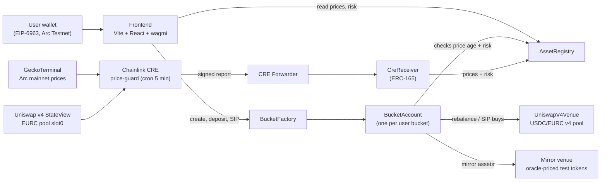

# Arcline

**A spot exchange on Arc focused on risk-managed rebalancing and SIP (systematic) investing.** Users trade FX, crypto and RWA tokens against USDC, or put USDC into **buckets**: per-user smart accounts that hold a target mix, rebalance when drift passes a band, and buy on a schedule (SIP). A Chainlink CRE workflow posts prices and risk flags on-chain, and the contracts refuse to trade on stale or flagged prices.

Built end to end in Arc Studio at ETHGlobal Mumbai (Nov 5–7, 2026). **Arc Testnet only: test tokens, no real money, not investment advice.**

## Submission: Circle Arc, "Best DeFi / Onchain Finance App Built End to End in Arc Studio"

| Requirement (per the prize page) | Status |
|---|---|
| Built in Arc Studio, shareable project URL | ✅ https://studio.arc.io/app/19d66b3b-3b80-4789-af6c-37430065da78 |
| DeFi / onchain finance app on Arc, USDC or EURC settlement | ✅ All trades, buckets and SIPs settle in USDC; USDC/EURC trades on a Uniswap v4 pool on Arc Testnet |
| Functional MVP (frontend + backend) and architecture diagram | ✅ App in `app/`, contracts below, CRE workflow in `cre/`; diagram below |
| Working end to end on Arc Testnet | ✅ `node ops/e2e.cjs` — trades on both venues, bucket deposit + rebalance, SIP gates |
| Video demo: core functions and use of Arc Studio / Circle tools | ⏳ Not recorded yet |
| Link to GitHub repo; state the bounty in the submission | ⏳ Repo not published yet; bounty stated above |

Also submitting to **Uniswap Foundation — Build with Uniswap** (see [Uniswap v4 integration](#uniswap-v4-integration) and [`FEEDBACK.md`](FEEDBACK.md)) and **Chainlink — Best workflow with CRE** (`cre/price-guard`).

## What it does

- **Markets and trade:** a live markets table, with a trade terminal per asset (candlestick chart, order ticket, risk status). Prices come from the on-chain oracle; 24h change, charts and liquidity are reference data from Arc mainnet (GeckoTerminal), labelled as such.
- **Buckets:** pick a template or build a custom mix, then set guardrails: drift band, max trade size per rebalance, max slippage and cooldown. Anyone can trigger a due rebalance, and the contract checks every gate (fresh prices, drift past the band, cooldown, not paused) before trading. Sells run first, then buys.
- **SIP:** a recurring USDC buy into a bucket, pulled from the owner's approved allowance when due.
- **Risk:** each asset has a risk level set by CRE (watch / no-buy / exit on 5 / 10 / 20 % pumps vs reference). Buckets stop buying flagged assets and sell assets at exit level.

## Architecture



**Why a receiver:** the Arc Testnet CRE forwarder only delivers to contracts that implement ERC-165 `supportsInterface`. `CreReceiver` implements it, accepts reports only from the forwarder, and relays them to the registry, which accepts only the receiver as its reporter.

## Contracts (Arc Testnet, chain 5042002)

| Contract | Address |
|---|---|
| AssetRegistry | [`0x79E3…5A47`](https://explorer.testnet.arc.io/address/0x79E37808c2187B949D36c0295C7947154CD85A47) |
| BucketFactory | [`0x6677…3875`](https://explorer.testnet.arc.io/address/0x6677b355ca5c21c77198bfe62d223d3e8fc23875) |
| BucketAccount | [`0x97dc…6554`](https://explorer.testnet.arc.io/address/0x97dc3f2d27e8054c982c71e40db4bce315496554) |
| UniswapV4Venue | [`0x767f…6208`](https://explorer.testnet.arc.io/address/0x767f4a602d1944409482f57aad56fd5696586208) |
| Mirror venue | [`0xBaF8…B7a7`](https://explorer.testnet.arc.io/address/0xBaF806f5a0020F97ACB16f9f7501495b1473B7a7) |
| CreReceiver | [`0x97f1…04dd`](https://explorer.testnet.arc.io/address/0x97f154f7991948bcd218e96300a50b053eec04dd) |
| ArcTreasuryCore | [`0x1dcb…a6fc`](https://explorer.testnet.arc.io/address/0x1dcb59c9afab2e0f660206a9c8233454d6e3a6fc) |
| MirrorTokenBatch | [`0x6b12…24f2`](https://explorer.testnet.arc.io/address/0x6b12ce46563c92ebf9148dd33e41cba9699c24f2) |
| SeedRelay | [`0xf1f3…60a1`](https://explorer.testnet.arc.io/address/0xf1f34a52f70325581736aa5f4ad60423471460a1) |

Circle tokens: USDC `0x3600000000000000000000000000000000000000` (ERC-20, 6 decimals), EURC `0x89B50855Aa3bE2F677cD6303Cec089B5F319D72a`. Interfaces: [`studio/IArcTreasury.sol`](studio/IArcTreasury.sol).

## Uniswap v4 integration

Every USDC/EURC trade in the app — manual swaps and the EURC leg of every automated bucket
rebalance — settles through a **Uniswap v4 pool on Arc Testnet** (`fee: 500`, `tickSpacing: 10`,
no hooks). `UniswapV4Venue` talks to `IPoolManager` directly, with no periphery router, and holds
no liquidity of its own.

| What | Where |
|---|---|
| Venue contract | [`app/contracts/UniswapV4Venue.sol`](app/contracts/UniswapV4Venue.sol) |
| `swap()` → `poolManager.unlock()`, enforces `minOut` | [L72–L83](app/contracts/UniswapV4Venue.sol#L72) |
| `unlockCallback()` → `poolManager.swap()`, `BalanceDelta` checks, `sync`/`transfer`/settle | [L84–L101](app/contracts/UniswapV4Venue.sol#L84) |
| `quote()` via `IV4Quoter.quoteExactInputSingle` | [L56–L70](app/contracts/UniswapV4Venue.sol#L56) |
| Frontend quoting (`simulateContract`, since the Quoter reverts under `staticcall`) | [`hooks.ts:91`](app/src/components/trade/hooks.ts#L91) |
| Pool mid price from `StateView.getSlot0` | [`hooks.ts:130`](app/src/components/trade/hooks.ts#L130) |
| Deployed venue | [`0x767f4a60…86208`](https://explorer.testnet.arc.io/address/0x767f4a602d1944409482f57aad56fd5696586208) |

Developer feedback on the v4 integration: [`FEEDBACK.md`](FEEDBACK.md).

## Run

```bash
cd app && bun install
bunx vite --host 0.0.0.0 --port 5173 --strictPort
```

Oracle prices (needs a funded Arc Testnet key as `ARC_PRIVATE_KEY`, in the environment or an
untracked `.env`; never committed):

```bash
node ops/report-prices.cjs      # one round of prices
node ops/keeper-loop.cjs 240    # keep them fresh on a 4-minute loop
node ops/rebalance-keeper.cjs 120   # auto-rebalance every basket (and run due SIPs); --dry to simulate, --once for cron
node ops/snapshot-markets.cjs   # re-capture the landing snapshots + token logos (display only, ~2 min; public API is rate limited)
```

The same job runs in CI from [`.github/workflows/keeper.yml`](.github/workflows/keeper.yml) on a
5-minute cron, using an `ARC_PRIVATE_KEY` repository secret.

The Chainlink CRE workflow is the intended price source; the scripts above are a liveness
backstop because it is not deployed to a DON yet:

```bash
cd cre && cre workflow simulate ./price-guard -T staging-settings --non-interactive --broadcast \
  --config "$(pwd)/price-guard/config.staging.json" --trigger-index 0
```

### End-to-end test

```bash
node ops/e2e.cjs
```

Runs the whole flow against Arc Testnet and prints a pass/fail table: refresh prices → buy and
sell on the real Uniswap v4 venue → buy and sell on the mirror venue → bucket create → deposit →
rebalance (asserting the cooldown and drift-band gates, and that sells settle before buys) → SIP
configure, not-due gate, cancel. It spends real testnet USDC.

## Honest limits

- **Testnet only.** "Mirror" assets (cirBTC, WETH, XAUM, stocks and others) are test tokens priced from Arc mainnet references. Only USDC and EURC are Circle's real testnet tokens.
- **Prices go stale** after the registry's max age (1h), which blocks rebalances. The CRE workflow runs as a simulation with `--broadcast`; it is **not deployed to a DON yet** (that needs CRE deployment access). In the meantime `ops/keeper-loop.cjs` and the GitHub Action keep prices fresh using a project-held key — a **centralised liveness backstop, not a decentralised feed**. Auto-rebalancing works the same way: `rebalance()` is permissionless, so `ops/rebalance-keeper.cjs` (or the same GitHub Action) calls it for every basket, simulating first. It is a project-run keeper, not a decentralised network, and anyone else can run it too. Prices written that way are a trust assumption on us, not on Chainlink.
- **The testnet Uniswap v4 pool is shallow.** A single 1 USDC swap moved the USDC/EURC pool mid by ~11%. Because EURC's oracle price is read *from* that pool, an automated rebalance right after a manual trade can revert `MinOut` until the next price report resyncs the oracle. `ops/e2e.cjs` resyncs between the two phases for this reason. On a real pool this would not happen; on testnet it is a live constraint.
- **GeckoTerminal rate limits** can skip a price update for mirror assets; the UI shows those prices as stale rather than guessing. Prices are fetched in one batched `/tokens/multi` request to stay under the limit.
- **Charts for most assets come from on-chain oracle history, not market data.** GeckoTerminal indexes an Arc-mainnet pool for `cirBTC` only; for `WETH`, `GBPA`, `syrupUSDC`, `XAUM` and `ASTOCK` it returns a price but **zero pools**, so there are no candles to show. Those charts are built by folding `AssetRegistry.PriceUpdated` events into OHLC buckets, and the chart labels its source. Volume is genuinely zero in that mode, so the volume pane is hidden rather than drawn empty. Timeframes without at least two candles are disabled until enough history accumulates.
- **USDC is the gas token on Arc**, so the same balance pays for gas and funds trades. A test wallet that looks funded can still fail mid-flow.
- **No contract tests.** There is no `foundry.toml` and no `*.t.sol` in the repo; `bun run contracts:test` compiles nothing. Correctness is covered by the live end-to-end script above, not by unit tests.
- **Templates are examples, not recommendations.** Nothing here is investment advice.
- StableFX and USYC need permissioned access and are not integrated.

## Repo map

```
app/        Vite + React frontend (Arc Studio workspace copy), contracts under app/contracts
cre/        Chainlink CRE price-guard workflow (prices + pump/risk flags)
ops/        one-off admin scripts (reporter wiring, price report, smoke, verify)
studio/     Arc Studio prompts per turn, interfaces, CreReceiver source
```
